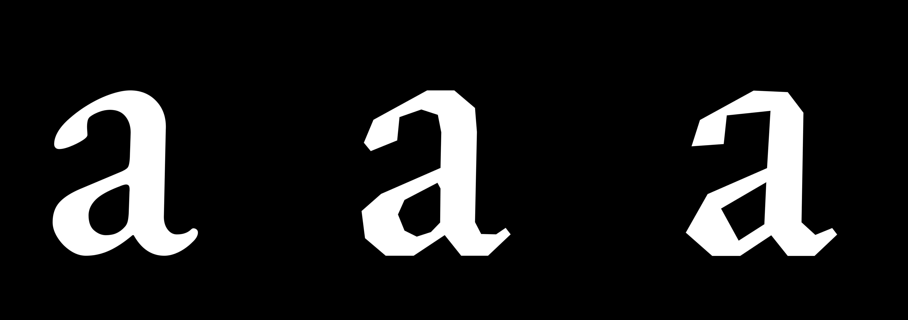

# None-Curve

[English](README.md) · **中文**

一个把字体曲线转换成可编辑多边形的实验性网页工具。载入字体、输入文字，调整控制项时，每个字母都会实时由直线重新构成。你可以让轮廓变成折面、方形、对齐网格或带有粗糙感，然后把单个字形或整段文字导出为 SVG，或把字形导出为 OpenType 字体。一切都在浏览器中完成，字体和音频文件不会被上传。

**第一次使用、不懂代码？** 请阅读 **[用户指南](docs/USER_GUIDE.zh.md)**——它用通俗的语言解释了屏幕上的每个区域和每个控制项。



## 功能状态

| 功能 | 状态 |
|---|---|
| 导入本地字体（.ttf / .otf / .woff / .woff2）和 Google Fonts，支持粘贴 Google Fonts 链接 | ✅ 已实现 |
| 字形列表、原始曲线骨架、Original / Flattened / Compare 视图 | ✅ 已实现 |
| 曲线展平（自适应或固定线段数，可选合并相连曲线） | ✅ 已实现 |
| 方形化（圆形 O → 方形 O）、锚点间距与简化、网格吸附、角度锁定、确定性扰动 | ✅ 已实现 |
| 在原始曲线上随机取锚点，可用种子复现 | ✅ 已实现 |
| Experimental 标签页：Noise（沿笔直折痕揉皱的纸）、Ripple（多边形波纹）、Curl（直边漩涡）、Wind（被拉长的阵风尾迹），全部可叠加 | 🧪 实验性 |
| 实时文字预览：保留字宽、字偶距、多行与缺字标记 | ✅ 已实现 |
| 画布（画板）尺寸、常用画幅比例与 1×–4× 导出倍数；排版（字号、字间距、行距、倾斜、对齐、大小写）；配色预设与自定义颜色 | ✅ 已实现 |
| 导出画布的 SVG 与 PNG，可选带上预览的模糊与反色 | ✅ 已实现 |
| 导出 OpenType 字体（CFF，.otf），导出后自动校验 | ✅ 已实现——见[限制](#字体文件) |
| TTF / WOFF / WOFF2 输出；导出字偶距与 OpenType 特性 | ❌ 不支持 |
| Sound 标签页：本地音频文件或麦克风，实时测量（20 个特征：响度与缓变响度、频带与窄频带、亮度、噪声度、音高、节拍与底鼓脉冲、变化、速度，以及文件的立体声声像与宽度）并以紧凑的电平表显示；最多 8 个映射实时移动 Geometry 和 Experimental 的滑块，并让三个种子跳变（锚点随声音跳到新位置），选择目标时会打开它需要的设置；带滑块上的实时值标记、实时种子、实时帧率、闪烁限制和 Freeze | 🧪 实验性——开发中，见[声音](#声音) |
| 声音事件：Step 映射（Allowed directions、Sides、Rings）、预设 | ⏳ 规划中，尚未实现 |

## 文档

| 文档 | English | 中文 |
|---|---|---|
| 用户指南（面向设计师，无需代码） | [docs/USER_GUIDE.md](docs/USER_GUIDE.md) | [docs/USER_GUIDE.zh.md](docs/USER_GUIDE.zh.md) |
| 产品需求文档 | [docs/PRD.md](docs/PRD.md) | [docs/PRD.zh.md](docs/PRD.zh.md) |
| 实施计划 | [docs/PHASE.md](docs/PHASE.md) | [docs/PHASE.zh.md](docs/PHASE.zh.md) |
| 声音计划 | [docs/SOUND_PLAN.md](docs/SOUND_PLAN.md) | [docs/SOUND_PLAN.zh.md](docs/SOUND_PLAN.zh.md) |
| 项目约定 | [docs/BEST_PRACTICE.md](docs/BEST_PRACTICE.md) | [docs/BEST_PRACTICE.zh.md](docs/BEST_PRACTICE.zh.md) |

## 运行

- **在线：** `main` 分支部署后访问 `https://m1ingx1xx1.github.io/None-Curve/`（见[部署到 GitHub Pages](#部署到-github-pages)）。
- **本地：** 需要 Node.js 20.19 及以上（推荐 22）。

```bash
npm install       # 安装依赖
npm run dev       # 开发服务器：http://localhost:5173/
npm run build     # 类型检查 + 生产构建，输出到 dist/
npm run preview   # 预览生产构建：http://localhost:4173/None-Curve/
```

## 界面

```text
┌────────────────────────╥───────────────────────────────────────────────────┐
│ 功能区                 ║ 结果画布                                          │
│ 导入 · 字体信息        ║ 只显示输入的文字                                  │
│ 几何参数（可滚动）     ║                                                   │
╞════════════════════════╩═════╦═════════════════════╦═══════════════════════╡
│ 排版 / 字形 / 颜色           ║ 文字输入            ║ 预览 + 模糊/反色      │
└──────────────────────────────╨─────────────────────╨───────────────────────┘
```

双线是拖动手柄。每个手柄只移动两侧区域之间的分界线，两侧加起来的大小始终不变：上下两行始终正好填满标题栏和状态栏之间的窗口高度（页面不会滚动）；功能区和画布平分上面一行的宽度；下面一行的排版 / 字形 / 颜色标签页、文字输入和预览加起来始终等于这一行的宽度（最小宽度依次为 260、180、200 像素）。每个手柄就是那条 1 像素的分隔线本身（和标题栏、状态栏的边线一样用低调的边框色），另有 9 像素宽的隐形拖动区域。可以拖动手柄，或让手柄获得焦点后用方向键调整（Home / End 跳到两端）；双击恢复默认。每个区域都保留最小尺寸，分隔比例会记在浏览器里。上下两行各自独立调整，所以它们的竖向分界线不一定对齐。

- **左上——功能区：** 最上方是 **Import font** 和字体信息，下面是 **Geometry（几何）**、**Experimental（实验）** 和 **Sound（声音）** 三个标签页。**Geometry** 按流水线顺序排列全部几何参数（展平、方形化、锚点、网格与角度、扰动），最后是随机锚点；**Experimental** 放在它之后运行、可以同时打开的效果（Noise、Ripple、Curl、Wind）；**Sound** 播放本地音频文件或通过麦克风收音，显示实时电平表，并通过映射让声音移动另外两个标签页的滑块，或让它们的种子跳变；被驱动的滑块保留自己的值，并用一条细标记显示实时值；被驱动的种子输入框保留自己的种子，并在旁边显示实时种子（见[声音](#声音)）。浏览器会记住当前选中的标签页。参数区的统计数字针对当前选中的字形。当前不起作用的控件会变灰：随机锚点开启时整个曲线展平组变灰；随机程度为 0% 时随机种子变灰。各项说明默认收起在标签旁的 ⓘ 按钮后面（点击或轻触展开，因此触屏和键盘都能用；收起时文字仍作为控件的读屏描述）；面板内容上方的 **Show all explanations** 可以一次展开全部（包括排版和颜色标签页里的说明），并会记在浏览器里。警告、统计数字以及“为什么这个控件变灰”的说明始终显示。
- **右上——结果画布：** 显示画布（画板）及其上输入框里的文字，使用当前字体、全部参数、排版设置和颜色。画布下方的 **Canvas size** 可以展开或收起画布尺寸抽屉（见[画布尺寸](#画布尺寸)），展开状态会被记住。它的轮廓视图与图层开关（Original / Flattened / Compare、Fill、Skeleton、Vertices、Metrics）也同时作用于预览；缩放与平移只影响画布。每个字形的点击范围是它的字框（字宽 × 上伸到下伸），所以小字也很容易点中。点击字形即可选中它（统计数字随之切换），并把它在文中的每一处都换成高亮色（鼠标悬停时也一样）。高亮色由文字颜色和背景颜色计算得出：在背景上仍然易读的颜色中（对比度至少等于文字本身的对比度，最高要求 4.5 : 1，最低不低于 3 : 1），选出在色相和色度上与文字颜色差别最大的一个（OKLab），偏向鲜艳的颜色，避免亮度往背景方向褪，并且色相与配色的色相相差不超过 40°（文字本身已经很鲜艳、40° 内拉不开差别时放宽到 90°；先取文字的色相，文字无色时取背景的，都无色时取橙色）。米色纸上的黑字会高亮为朱红；彩色文字会高亮为相邻色相中更鲜艳的颜色。点击画布空白处（拖动结束时不算）或按 Esc 取消高亮；统计数字仍显示最后选中的字形，Geometry 面板顶部的 **Statistics** 一行会写明是哪个字形（字符和编码）。预览从不显示高亮。
- **左下——文字工具：** 三个标签页（会记在浏览器里，可用方向键切换；始终保持加载，切换时不会丢失局部状态）：**Typography（排版）**——文字在画布上如何排布（见[排版](#排版)）；**Glyphs（字形）**——见下条；**Color（颜色）**——文字与背景的颜色。
- **Glyphs 标签页：** 可搜索的字符网格，列出字体映射的所有字符，用作插入器：点击字符会把它插入到文字输入框的光标处（有选中文字时替换选中部分），并选中该字形。输入框从未获得焦点时，字符追加到末尾。没有对应字符的字形（连字、替代字形）和控制字符无法输入，因此不列出。字形列表窄于 280 像素时，格子会缩小并只显示字符本身；超过这个宽度时重新显示 Unicode 编码（编码始终保留在每个格子的悬停提示里）。
- **右下——输入与预览：** 左边是紧凑的多行文字输入（Text 标题右边的大小写开关 **AA** / **Aa** / **aa**、示例文本菜单、Clear、字符数、字偶距状态、缺字提示）；右边是画布按导出效果显示的缩小版（裁到画布边缘），带独立的 **Blur（模糊）** 滑块（0–12 像素）和 **Invert（反色）** 按钮（交换文字与背景的颜色）。除非勾选 **Export the preview look**，模糊和反色只作用于这个视图，相当于“眯眼看整体字形”。两部分之间有一个拖动手柄，可以移动分界线（默认 40 / 60）。
- **状态栏：** 字体状态、选中的字形和当前视图；Sound 驱动字母期间显示 **Live · N fps**（实时帧率）；麦克风收音期间显示 **Microphone on**（在任何标签页都能看到；窄屏下浮在屏幕右下角），麦克风自己停止时（被拔出或权限被收回）显示 **No microphone**；最右端是一个小小的界面亮色 / 暗色切换。每次打开都先按系统设置（`prefers-color-scheme`），系统设置改变时也会跟随；在这里的选择只在本次访问有效，不会保存。主题色是 CSS `light-dark()` 值，由 `<html data-theme>` 上的 `color-scheme` 切换。画布在两种主题下都使用颜色设置里的配色。
- 窄屏下纵向排列（没有拖动手柄）：导入与字体信息、画布（至少占视口高度的 62%）、参数（默认收起，点画布工具栏的 **Parameters** 展开）、文字输入、预览、排版 / 字形 / 颜色标签页。

### 画布

- 轮廓视图：**Original**（字体原始曲线）、**Flattened**（最终多边形）、**Compare**（最终多边形，叠加原始曲线虚线）。当前视图显示在画布角落和状态栏。
- 图层：**Fill**（关闭后显示描边）、**Skeleton**（原始曲线上锚点为方块、曲线外控制点为空心圆，以及控制柄；TrueType 的隐含节点也显示为锚点）、**Vertices**（最终多边形顶点，绿色圆点）、**Metrics**（上伸线、大写高度、x 高度、基线、下伸线、字宽）。
- 用鼠标滚轮或 `+` / `−` 缩放，拖拽或方向键（画布获得焦点时）平移，`0` 或 **Fit** 复位。右下角的预览始终适配全文，不能交互。
- 所有图层都作用于文字中的每个字形。只绘制可见范围内的字形；每个 em 在屏幕上不小于 48 像素时才显示骨架点和顶点，否则画布提示放大，长文本因此仍可辨认。度量线的文字标签只标在第一条可见行上。

### 画布尺寸

文字排在一个固定像素尺寸的画布（画板）上；缩放 100% 时完整显示整个画布。背景色铺满整个视图。画板以外（工作区）比背景色暗 7%（深色背景则亮 6%），并铺有屏幕网格（每 24 像素一格），浅色背景上用黑色、深色背景上用白色，不透明度取到与背景的对比度为 1.3 : 1——无论文字是什么颜色，每种配色下的可见度都一样（`src/specimen/color.ts` 中的 `gridLineColor`；Grid & angles 的吸附网格为 1.5 : 1）；画板以内和导出效果完全一样。只有在需要对齐时，网格才会淡入到画板内：拖动文字时（Free 位置），或缩放到 200% 及以上时。一条带柔和阴影的 1.5 像素外框（目前设为透明，只留阴影）标出导出区域，并让它从周围的背景上浮起——外框用界面的薄荷绿（#adfce7；在背景上更显眼时用 #0f7a5c），而不是文字颜色，所以不会被误认为文字的一部分；阴影在浅色背景上是深色投影，在深色背景上是浅色光晕（`src/styles.css` 中的 `.artboard-frame`）；度量线也用文字颜色绘制。透明背景显示为棋盘格，由背景色和叠了文字颜色的背景色组成，因此文字依然清晰。画布下方的抽屉包含：

- **W** / **H**：画布宽和高，100–4000 像素（滑块或数字框；数字框在按回车或离开时生效，并限制在范围内）。
- 画幅比例 **1:1**、**4:3**、**16:9**、**4:5**、**3:2**、**3:4**：保持宽度、按比例设定高度（若超出范围则改为保持高度）；与当前尺寸相符的比例会高亮。**Swap** 交换宽和高。
- **1×–4×**：导出倍数。PNG 的尺寸为宽 × 倍数、高 × 倍数，排版不变，倍数越高越清晰。

超出画布边缘的文字在画布上仍可见并给出提示；预览和导出会裁到画布边缘。

### 排版

`src/specimen/artboard.ts` 与 `src/specimen/scene.ts`。这些设置改变排版和 SVG/PNG 导出，不改变字形几何，也不影响字体文件。

- **Size（字号）**（4–1000 像素，默认 48）：每个 em 在画布上的像素数；改变画布尺寸不会改变字号。**Fit text** 设为能让轮廓（含倾斜）在两个方向上都放进边距内的最大整数像素字号。
- **边距**：位置锚点和 Fit text 在字形轮廓与画布四边之间固定保留 25 个画布像素，与字号无关（`src/specimen/artboard.ts` 中的 `EDGE_MARGIN_PX`），没有对应的控件。
- **Tracking（字间距）**（−200–1000，单位千分之一 em）：在字宽和字偶距之外加在字形之间，不加在每行最后一个字之后。
- **Line height（行距）**（0.5–3 倍）：字体行距（上伸 − 下伸 + 行间隙）的倍数。
- **Slant（倾斜）**（−30°–30°）：绕每个字形自己的基线做错切（x′ = x + tan(倾斜) · y），正值向右倾。
- **Align（对齐）** Left / Center / Right（图标按钮）：整块文字内部行与行之间的对齐。
- **Position（位置）**：整块文字在画布上的位置。九个锚点（3 × 3 网格：四角、四边中点、正中）按轮廓的范围（含倾斜；不是行框，所以字身两侧的留白和上伸空间不会留下空隙）把文字贴到左边距、水平居中或贴到右边距，以及贴到上边距、垂直居中或贴到下边距——字母离画布的边和角 25 像素。点锚点时也会按它所在的列设置 **Align**（左列靠左、中列居中、右列靠右），之后仍可单独更改 Align。默认是左侧、垂直居中。选中的锚点（以及开启时的 Free）会以主色薄荷绿发光。**Free（自由）** 时可以在画布上拖动文字（从别处开始的拖动仍是平移视图）；位置记为画布在轮廓范围旁边和上方留出的空间的比例，所以文字到画布边缘就停住，改变字号或画布尺寸后也仍在画布内。点 Free 会先把文字放回默认位置和对齐（左侧、垂直居中），然后就可以拖动；再点一次会重新回到默认位置。
- **大小写**（Text 标题右边的 **AA** / **Aa** / **aa**）：**All caps**（全大写）、**Title case**（每个单词首字母大写、其余小写）或 **Lower**（全小写）；再点一次已选中的按钮即恢复原样。输入的文字本身从不改变；画布、预览、导出以及字体文件的 “Specimen characters” 都使用转换后的文字。
- **Reset typography** 恢复默认值（4%、0、1、0°、左对齐、位置为左侧垂直居中），保留大小写设置。

### 颜色

十二个预设（Charcoal——默认，浅底深字——以及 Off White、Kryptonite、Plum、Glowing Cyan、Acid Lime、Ember、Moonlit Purple、Chrome Pink、Cherry、Atomic Blue、Forest Moss），**Random**（随机生成一组易读的配色，对比度 ≥ 4.5 : 1），**Swap**（交换），以及自定义 **Text**（文字）与 **Background**（背景）颜色：取色器加十六进制输入框（`#rgb` 或 `#rrggbb`）。面板会显示对比度，低于 3 : 1 时给出警告。**Transparent background** 让 SVG 和 PNG 导出不含背景；背景色仍保留，供 Swap、Invert 和棋盘格使用。画布上的悬停和选中使用由文字颜色和背景颜色计算出的高亮色（见上文的结果画布）。

### 文字预览

输入的文字使用共享几何缓存中的最终多边形排布，因此画布、预览和导出结果始终一致。

- 每个字形按字宽推进，并在字体带有字偶距数据时应用字偶距（GPOS `kern` 特性或旧版 `kern` 表，经 fontkit 排版）。连字关闭，每个字符保持自己的字形。没有字偶距数据的字体会明确标注。
- 行高 = （上伸 − 下伸 + 字体行距）× **Line height**。空格只推进不绘制。缺字以虚线框标出并列出。
- 最多显示 1000 个字符。同一组参数下，每个不同的字形只处理一次（缓存键：字体、字形和全部几何参数）。

### 性能

- **几何 Worker**（`src/geometry/geometry.worker.ts`、`src/state/geometryClient.ts`）：几何流水线在 Web Worker 中运行，Worker 自己打开一份字体，页面从不需要等它。先算选中的字形（统计数字），再按阅读顺序算文字中的字形；结果约每 40 毫秒分批返回，并合并显示（每 50 毫秒最多重绘一次）。新的参数会在字形之间打断旧的计算。新形状到达之前，画布继续显示该字形之前的形状，画布角标显示 “Updating N…”（声音驱动字母时，实时帧一帧接一帧替换，不显示角标；此时角标只计还没有任何形状的字形）。最近四组参数的结果会保留，退回之前的设置时立即可见（声音驱动的实时帧单独保存，所以一首歌不会把它们挤掉；见[声音](#声音)）。浏览器不支持 Worker、或 Worker 打不开字体时，仍在页面上计算。导出使用 Worker 已有的结果，只补算缺少的字形。
- **文字排版**拆成两步：排字（`shapeSpecimen`，只在文字或排版设置变化时重算）和放置多边形（`placePolygons`，结果到达时重算）。路径字符串和倾斜后的范围按多边形缓存，画布上每个字形都是记忆化组件，所以重复出现的字母只生成一次轮廓，没有变化的字形不会重绘。
- **Free 位置拖动**只用 SVG 变换移动文字，松手时才提交一次位置，拖动过程中页面不重新渲染。
- **相交检测**（`src/geometry/crossings.ts`）：每个步骤对每个轮廓、每次重试都要检测。现在按 x 排序扫描线段，只比较包围盒重叠的线段对；交点数一超过原有数量就停止；每个轮廓自身的交点数只算一次。15 000 个点的轮廓（Anchor spacing 1）检测只需几毫秒，而不是几秒。两个轮廓之间的检查（`src/geometry/contourLayout.ts`）先比较包围盒，只看重叠区域内的线段；每对轮廓原来的位置关系，每一步只算一次。
- **几何缓存**：每款字体超过 4000 个字形或 1 000 000 个多边形点时，丢弃最久未用的条目，密集设置不会耗尽内存。声音驱动的实时帧使用另一个更小的缓存（每款字体 600 个字形或 200 000 个点），所以从不挤掉这里的条目。
- 实测（生产构建，1000 个字符，Inter）：拖动 Tolerance 滑块每一步占用页面约 10 毫秒（原约 90 毫秒），Random anchors 密度 100 约 9 毫秒（原 260–690 毫秒）；间距 1 + 网格 50 + 15° + 扭曲时，“@” 需要 48 毫秒（原 2.8 秒）；间距 1 时计算并取整 Arial 全部 2691 个字形需 3 秒、常驻内存约 200 MB。

## 字体

### 本地文件

- 格式：`.ttf`、`.otf`（TrueType 与 CFF 轮廓）、`.woff`、`.woff2`，按文件内容识别而不是扩展名。暂不支持字体集合（`.ttc` / `.otc`）。
- 通过 **Import font** 选择文件，或直接拖到画布上。文件只在浏览器内读取，不会上传。上限 50 MB。
- 空文件、无法识别的文件和损坏的文件会给出不同的错误提示和 **Retry**；之前载入的字体保持显示。

### Google Fonts

CSS 预览字体拿不到轮廓数据，因此应用会下载真实的字体文件：

1. `GET https://fonts.googleapis.com/css2?family=<Family>:ital,wght@0,100;…;1,900`——官方 CSS2 接口，无需 API key。只返回实际存在的样式，每个字符子集一条 `@font-face`，允许跨域。
2. `GET https://fonts.gstatic.com/s/<family>/<version>/<file>.woff2`，取所选字重、样式和子集对应的文件。
3. 用 fontkit 解析 WOFF2。解析成功后字体才可用。

限制：

- **目录：** 完整的可搜索目录需要 Google Fonts Developer API key，静态网站无法保密。对话框提供15 个精选字体（无衬线：Google Sans、Noto Sans、Archivo、Inter、DM Sans；衬线：EB Garamond、Baskervville、Bodoni Moda、DM Serif Display；粗衬线：Slabo 13px、Arvo；等宽：IBM Plex Mono、JetBrains Mono、Space Mono、DM Mono）、可输入与 fonts.google.com 完全一致的字体名称（区分大小写），也可粘贴 Google Fonts 链接。
- **字符子集：** Google 按子集（latin、latin-ext、cyrillic 等）拆分文件，一次只加载一个子集。
- **可变字体：** 当多个字重共用一个文件时识别为可变字体。仍然可以选择任何字重：所选字重会单独向 Google 请求，Google 会返回为该字重生成的静态文件（样式名和 OS/2 字重都正确）。如果 Google 仍返回可变文件（例如 Roboto Flex 的 700），则在载入时应用字重：fontkit 无法对 WOFF2 文件应用变体，所以先把 WOFF2 重建为 TrueType（`src/font/woff2.ts`：重新编码解码后的字形表，不含 hinting，其他表原样复制），再按该字重生成实例；字体面板会注明所用的字重。其他轴（`opsz`、`wdth` 等）保持默认值。
- **彩色字体**（Nabla、Honk、Bungee Spice、各个 “Ink” 字族）：只读取它们的普通轮廓；fontkit 读不了 COLR 第 1 版，所以绕过它的彩色字形（COLR、sbix）。字形只有彩色图像的字体（Noto Color Emoji）可以载入，但会提示没有可编辑的轮廓。
- **fontkit 读不了排版表的字体**（Iosevka Charon）按每个字符一个字形、使用字宽排列，不做字偶距。
- 已用整个 Google Fonts 目录（1950 个字族）检查：每个字族都能载入，每个可变字族在第二个字重下也能载入，且轮廓与默认字重不同。
- **错误：** 未知字体名返回 HTTP 400 且不带 CORS 头，浏览器看来与断网相同。应用会再发一次 `no-cors` 请求，区分“Google 拒绝了这个名字”和“网络 / CORS / 拦截插件”。下载失败与解析失败分别提示，都可 **Retry**。

#### 粘贴 Google Fonts 链接

链接由 `src/font/googleUrl.ts` 解析，链接本身不会被请求——只从中读出字体名和样式，再走上面的下载流程。

| 链接 | 读取内容 |
|---|---|
| `https://fonts.google.com/specimen/Roboto` | 字体名（`+` 代表空格）。`categoryFilters`、`preview.script` 等参数会被忽略并列出。 |
| `https://fonts.googleapis.com/css2?family=Roboto:ital,wght@1,700` | 从第一组样式中读取字体名、字重和斜体。字重范围（`wght@300..700`）表示在对话框中选择字重。 |
| `https://fonts.googleapis.com/css?family=Lato:300italic` | 旧版接口：字体名和第一个样式（`400`、`700italic`、`300i`、`bold`）。 |

- 只接受 `https://` 开头、域名为 `fonts.google.com` 或 `fonts.googleapis.com` 的链接。其他网站、仿冒域名、`http://`、带账号密码或端口的链接以及其他路径都会被拒绝并说明原因。
- 链接包含多个字体或样式时只用第一个，对话框会说明。`display`、`subset`、`text` 和追踪参数会被忽略并列出。
- `wght` 和 `ital` 以外的轴（如 `opsz`、`wdth`）无法应用；对话框会说明，这些轴保持默认值。
- 请求的样式不存在时按默认规则（最接近 400）回退，并写明实际加载的样式。

## 几何流水线

```text
原始曲线（只读）→ 展平（或随机锚点）→ 方形化 → 锚点间距 → 锚点简化 → 网格吸附 → 角度锁定 → 顶点扰动 → 实验效果（Noise → Ripple → Curl → Wind）→ 最终多边形
```

顺序固定（`src/geometry/pipeline.ts`）。每次参数变化都会从原始曲线重新运行整条流水线，不会累积误差；关闭某一步就精确回到它之前的结果。所有距离都以字体单位计算，与画布缩放无关。扰动和实验效果最后执行，因此会让顶点离开吸附网格和锁定角度。

每一步都会逐个检查轮廓：至少三个不同的点、方向不变（字腔仍是洞）、面积不为零、自相交不增加。同时还要检查它和同一字形其他轮廓的位置关系是否不变（`src/geometry/contourLayout.ts`）：原本分开的轮廓仍然分开，字腔仍在外轮廓里面，没有轮廓跑进另一个轮廓。否则字腔被推出字母后，会被填成字母旁边的一块实心。各步骤逐个修改轮廓，每个新轮廓都和其他轮廓当时的状态比较，所以整个字形最终也是合格的。展平本身则与原始曲线的极细展平结果比较（见下文）。

在放弃之前，各步骤会逐级退让：方形化使用仍然安全的最大比例（并比极限略微回退，给后续步骤留出余地）；网格吸附和角度锁定会在逐步简化的轮廓副本上重试，角度锁定最后还会改用阶梯（把不在允许方向上的边拆成两段允许方向的边，不移动任何顶点）；扰动先只在相交处附近降低幅度，再整体降低。只有所有尝试都失败的轮廓才保持上一步的形状；面板会分别报告被减弱、被简化和保持不变的轮廓，以及原因。

在 Arial、New York、Georgia 的拉丁字形上实测，轮廓之间互相穿过或跑出彼此的字形比例：角度锁定 90° 从 13–25% 降到 0，随机锚点密度 1 从 16–18% 降到 0，网格 200 从 25–31% 降到 0，扰动 200 从 4–18% 降到 0，合并曲线且每条 1 段从 0–5% 降到 0。在四款字体上随机测试 6480 组参数组合，没有任何字形新增相交（无论是轮廓自身还是两个轮廓之间）。

### 曲线展平

每段二次和三次曲线都被替换为直线段（`src/geometry/flatten.ts`），结果只包含 `M`、`L`、`Z`。

- **Adaptive（自适应容差）**——递归中点细分（de Casteljau）。当子曲线到弦的最大偏差上界不超过容差时，变成一条直线（二次曲线取控制点距离的一半，三次曲线取较大控制点距离的 ¾）。范围 0.1–500 字体单位，滑块为对数刻度。不合并时每段字体曲线至少保留一条边，所以容差超过约 100 后几乎没有变化（Roboto 前 400 个字形在 100 和 500 时都是 11,219 个顶点）；想要更粗犷的形状请打开 **Merge joined curves**。安全上限：递归深度 12、最小子曲线长度 0.01；达到上限的曲线会被报告。
- **Fixed segments（固定线段数）**——每段曲线按 `t = i/N` 取点，正好变成 N 条边（1–32）。直线段保持一条边。任何边偏离曲线超过 em 的 1% 时显示警告。
- **Merge joined curves（合并相连曲线）**（两种模式都可用，默认关闭，合并相关设置两种模式共用；`src/geometry/curveRuns.ts`）——字体中一条看得见的曲线往往由多段 Bézier 组成（Roboto 的 O 每个轮廓有 16 段），所以单靠逐段设置仍然平滑。合并会把平滑相接的曲线段视为一条曲线：固定模式下按弧长均匀分成 N 条边；自适应模式下对整条曲线做简化（在曲线的密集采样上用 Ramer–Douglas–Peucker），保证每个采样点到对应边的距离不超过容差，闭合整圈至少 3 条边。顶点都落在曲线上。实测 Roboto 前 400 个字形（自适应）：容差 500 合并后 6,365 个顶点，不合并为 11,219 个；`o` 从 36 个顶点降到 12 个（Inter 从 24 降到 8）。
  - **Break merged curves at（断开位置）：** **Corners & extremes**（默认）——在尖角、直线段，以及曲线的水平 / 垂直极值点断开（极值点按解析方式求出，即使位于某段曲线中间），圆形字碗因此分成四段四分之一弧。**Corners only**——只在尖角和直线段断开，整圈平滑的轮廓变成一条曲线，至少使用 3 条边。
  - **Merge through straight lines（穿过直线合并）**（默认关闭）：与相邻部分平滑相接的直线段也并入合并曲线，例如 n、m、u 的竖笔流进弧线，或某些字体里 O 的直边，它们会和曲线一起重新取点。开启后，“极值点断开”只在两段曲线之间生效（竖笔正好在弧线的极值点处相接）。单独剩下的直线保持原样。字形变化很大，竖笔的端点可能被削掉。
  - **Corner angle（尖角阈值）**（1–90°，默认 15°）：转角超过该值的连接点一定断开。合并后的曲线也会在轮廓起点断开。不开启“穿过直线合并”时，它只影响曲线与曲线之间的连接点，而大多数字体里这些连接点本来就是平滑的（Roboto 的 6206 个中有 6200 个转角小于 1°），所以几乎没有变化。开启后，它决定哪些涉及直线的连接点会被合并：从 15° 调到 90°，Roboto 前 400 个字形中有 365 个发生变化。
  - Roboto `a` 实测：38 段曲线合并成 12 条；N = 4 / 3 / 2 / 1 时分别为 57 / 45 / 33 / 21 个顶点（不合并时 N = 1 也有 47 个）。
  - 合并后不合格的轮廓会改用不合并的结果，面板会说明。合并时不显示“偏离 1% em”的警告。

- **校验**：结果会与一份极细的展平结果（容差 1/5000 em，代表原始曲线）比较。如果某条边横穿了比容差还细的笔画，使轮廓在原始曲线没有相交的地方与自身或另一个轮廓相交，就只把相关的曲线重新展平：每轮自适应模式容差缩小到 1/4、固定模式边数加倍，最多 6 轮；面板会显示被加细的曲线数量。New York 的 U、Ù、Ú、Û、Ü 以及 6、9 在默认设置下原本会自交，现在不会了。
- 没有面积的轮廓（少于三个点，或所有点在一条直线上）会被去掉，面板会注明。

轮廓保持起点、顺序和方向；字宽和左右边距保留。没有轮廓的字形（如空格）得到空多边形。

### 方形化

展平只是近似原曲线，所以 O 仍然是圆的。**Squaring（方形化）**（`src/geometry/squaring.ts`）会有意把圆形轮廓推向它的包围矩形。

- 每个轮廓按自己的包围盒归一化，每个点从盒子中心沿径向移向盒子边缘。100% 时点落在盒子上，圆、椭圆、超椭圆都变成带尖角的包围矩形。**Amount**（0–100%，预设 Off / Soft / Square）线性过渡。
- 字腔用自己的包围盒，变成同心的小矩形，因此四边中点处的笔画粗细不变（Roboto 的 O 在 100% 时左侧笔画仍为 191，底部仍为 163）。
- **Applies to: Round contours**（默认）只方形化接近包围盒内切椭圆的轮廓（按边长加权的平均偏差 ≤ 0.06 时完全方形化，≥ 0.16 时不处理）；竖笔、三角形、S 形曲线以及 B / D 形轮廓保持不变。**All contours** 会把所有轮廓推向包围盒。
- 紧接在展平之后执行，之后的锚点简化可以去掉直边上的共线点（方形 O 简化后只剩 4 个角加起点）。
- 100% 时，Roboto、Inter、Andale Mono 的 O、o、0 外轮廓和字腔的“面积 ÷ 包围盒面积”都达到 1.00（圆约为 0.79）。

### 锚点间距与简化

`src/geometry/anchors.ts`。设为 0 即关闭；**Reset anchors** 同时关闭两者。

- **Anchor spacing（锚点间距）**（0–200 字体单位）：把每条边（包括回到起点的闭合边）等分成不超过目标长度的小段。新点落在原有边上，形状不变。单个字形超过 50,000 个顶点时跳过并提示。
- **Anchor reduction（锚点简化）**（0–100 字体单位）：对每个闭合轮廓做 Ramer–Douglas–Peucker 简化，在起点（始终保留）和离起点最远的顶点处分成两段。数值越大删除的点越多，可能抹掉小细节。字体中原本就自相交的轮廓会保留已有交叉，但不会增加。
- 间距插入的点与原边共线，两者同时开启时简化会把它们再次删除，面板会提示。简化阈值是绝对的字体单位。

### 网格吸附与角度锁定

`src/geometry/constraints.ts`。**Reset grid & angles** 恢复默认值（都关闭，网格 10，45°）。

- **Snap to grid（网格吸附）**（网格大小 0–200 字体单位，0 为关闭）：每个坐标变为 `round(v / g) × g`，网格以字形原点为基准，正好一半时朝字形包围盒的中心取整，左右对称的字母吸附后仍然对称。落到同一点的相邻顶点会合并。画布上会画出网格仅供参考（比 4 像素更密时不画）。
- **Angle lock（角度锁定）**（90°、45°、30° 或 15° 的倍数，从水平方向逆时针计）：每条边转到最近的允许方向（等距时取逆时针方向），再只调整边长——用按边长加权的最小二乘让轮廓重新闭合。每条边只保留沿新方向的那部分长度，所以锁定会让曲线缩小（90° 下 O 的宽和高各缩约 30%）；因此结果会对齐到原轮廓的包围盒，而不是固定起点：90° 时宽和高分别缩放（只有横竖边，角度不变），其他角度用一个保持包围盒面积的等比缩放，水平居中、底边不动，字母仍坐在基线上。锁定使形状变化过大时不采用——有顶点移动超过轮廓包围盒对角线的 20%，或面积变化超过 30%（例如 S 的开口被挤没）；重试时最多简化对角线的 4%。一个字形整体锁定或整体用阶梯：只要有一个轮廓不采用，或者各轮廓分别锁定会让字形散开（Roboto 的 V 由两条重叠的腿组成，分别锁定后会变成两根分开的竖条），这个字形的所有轮廓都改用阶梯。阶梯保留每个顶点；长于 1/40 em 的斜边先切开，长斜线就变成贴着原线的细密台阶；台阶的拐角朝远离笔画的一侧（外轮廓朝外，字腔朝字腔内）；相邻两级台阶在内凹的尖角处会相交时，把其中一级翻到另一侧。台阶也相交时，该轮廓才保持原样。以前 Arial 的 Z 在 90° 下会向左滑约 800 单位压到前一个字母上，X 会掉到基线以下 512 单位；现在两者的包围盒都不变。在可打印 ASCII 上，Arial 90° 的最大顶点位移从 1024 降到 290 单位；未能锁定的轮廓数：Arial 90° 从 15 降到 0，45° 从 8 降到 0，30° 从 2 降到 0；New York 90° 从 24 降到 20（它的发丝线只有几个单位粗），45° 从 8 变为 11、30° 从 4 变为 5，因为以前放过的重叠现在会被拦下。“Largest move” 量的是每个原始顶点到新轮廓线的距离。
- 先吸附、后锁角；锁角会改变边长，部分顶点因此离开网格，面板会提示。

### 顶点扰动

`src/geometry/distortion.ts`。**Reset distortion** 恢复默认值（幅度为 0），但保留当前种子。

- **Noise amplitude（噪声幅度）**（0–200 字体单位）：顶点最多移动的距离；0 为关闭。
- **Noise frequency（噪声频率）**（0.5–50）：每 1000 字体单位轮廓长度上的起伏个数，按弧长采样，并在每个轮廓上首尾连续，不会出现接缝。
- **Normal bias（法线偏向）**（0–100%）：0% 让顶点沿轮廓滑动，100% 让顶点垂直于轮廓进出。
- **Seed（种子）**（0–999,999）和 **Next variant**（种子加 1）。不使用 `Math.random`、时间或渲染次数；同样的字形、参数和种子总是得到同样的形状。
- 边保护只限制一条边的两端沿这条边互相靠近的距离（最多为边长的一半），因此边不会塌缩或反向；垂直于轮廓的移动不受限制。先缩短沿轮廓方向的移动，只有不够时（例如很紧的弯道内侧）才缩短垂直方向的移动。以前对所有相对移动都加限制，轮廓越密扭曲越弱，因为密集轮廓上相邻顶点离得很近。
- 扭曲后的轮廓与自身或另一个轮廓相交时（密集轮廓的内凹拐角、细笔画、靠近外轮廓的字腔），只在相交处附近把幅度减半，并在两侧各一个幅度的轮廓长度内平滑过渡，最多 12 次；轮廓其余部分保持全幅度。仍不够时，整个轮廓以 1/2 到 1/16 的幅度重试，仍不行就不扰动。
- 在 Arial 的 32 个字母和数字上实测，幅度 40 时顶点移动距离的中位数在 Anchor spacing 关闭 / 10 / 1 下分别为 18 / 18 / 16 单位（以前为 18 / 6.5 / 0），幅度 200 时为 67 / 46 / 25（以前为 22 / 0.3 / 0）。

### 随机锚点

`src/geometry/randomAnchors.ts`。位于 Geometry 标签页最底部，默认关闭。开启后，锚点不再按展平的规则间距放置，而是放在**原始曲线**上按弧长随机选取的位置；每个锚点都直接在原始 Bézier 曲线上求值，因此严格落在字形轮廓上。之后照常经过方形化、锚点、网格和扰动。由于展平的结果被替换，开启期间整个曲线展平组会变灰（它的设置只会作用于退回的轮廓）。

- **Density（密度）**（1–100）：每 1000 字体单位轮廓长度大约放多少个锚点；每个轮廓至少保留 3 个。
- **Randomness（随机程度）**（0–100%）：分层抽样。每个锚点各占一小段轮廓；0% 放在这段的正中，100% 可落在这段内任意位置。锚点之间不会交换顺序，所以轮廓不会折回。
- **Keep sharp corners（保留尖角）**（默认开启）：原始轮廓上转角大于 30° 的连接点固定保留为锚点，每两个尖角之间的部分各自取样。
- **Seed（种子）**（0–999,999；随机程度为 0% 时种子不起作用，会变灰）：**Shuffle** 随机换一个新种子（只有这个按钮用到浏览器的随机数）；**Copy** 复制种子；**Previous** 列出本次会话里最近用过的 6 个种子，点一下即可回到它。种子也会显示在底部状态栏和导出对话框里。
- 可复现：随机数来自 (种子, 轮廓的形状, 尝试次数) 的哈希，因此同一字体、同一设置、同一种子总是得到同一个多边形。文本中重复出现的同一个字母形状相同，形状相同的不同字形（如拉丁 A 与希腊 Alpha）结果也相同；不同形状各自取样。
- 校验：如果某次取样让轮廓反向、塌缩、新增自相交，或与另一个轮廓相交、跑出另一个轮廓，会用派生种子重新取样（最多 4 次，结果依然确定）；都不合格时该轮廓改用展平的结果，面板会注明。
- **Reset random anchors** 恢复默认设置，但保留当前种子。

### 实验效果：Noise、Ripple、Curl 与 Wind

`src/geometry/noise.ts`、`src/geometry/ripple.ts`、`src/geometry/curl.ts` 和 `src/geometry/wind.ts`，基于共用的变形模块 `src/geometry/warp.ts`，由 `src/geometry/experimental.ts` 按固定顺序 Noise → Ripple → Curl → Wind 调用。**Geometry** 旁边的 **Experimental** 标签页放的是在整条几何流水线之后运行、可以同时打开的效果（计划见 [docs/EXPERIMENTAL_PLAN.zh.md](docs/EXPERIMENTAL_PLAN.zh.md)）。整个标签页共用一个 **Seed** 和 **Next variant**，另有 **Reset experimental**（保留种子）。

- **每个效果都是分段线性变形。** 把平面切成三角形，每个三角形各自做线性变换，在三角形边界上连续。直边在三角形内部保持完全笔直，只在穿过三角形边（折痕）的地方转折，新顶点也只加在那里。任何效果都不沿轮廓采样平滑函数，所以字母只会多出棱角，不会多出曲线。
- **从构造上保证有效，所以效果可以叠加。** 在 100% 以内，三角形不会翻转或压扁，因此每个变形都是一一映射：它不可能让轮廓自交或与别的轮廓交叉，也不可能把字腔推出字母；多个变形接连作用也一样。每个效果之后仍会检查轮廓：先把所有轮廓换成精确映射（它们在一起一定合格），再逐个尝试换成整理后的版本，只有与其他轮廓仍然合格时才替换。只有输入里既不相交也不相接的边新产生交叉才算出错（很重的几何设置可能让轮廓自己叠在自己身上）；另外，两条边如果都还是精确映射的原样、对应的输入边相距不到 0.05 单位，它们之间的交叉也不算：一一映射不可能让它们交叉，但很强的 Wind 可能把重度扰动留下的尖刺挤得极细，以致浮点误差让它们交叉。如果未被改动的两条边在输入里相距更远却交叉了，那就是真正的错误，仍会被拒绝。万一浮点误差让精确映射出错，该轮廓依次改用 1/2 到 1/16 的强度；都不行时整个字形保持原样。
- **整理，确保看起来不像曲线。** 转角小于 3° 的折痕会被去掉（被去掉的折痕离替代它的边不超过 em 的 1%）。然后，凡是连续 5 个以上、朝同一方向转 0.5°–20°、相邻边都短于 em 的 4% 的顶点（折线开始看起来像曲线就是这样），就去掉其中转角最小的折痕，直到不再有需要折痕才凑成的这种段落。输入自身的顶点已经构成的段落保持不变；输入的顶点永远不会被删除。前面效果的折痕也算作折痕，所以后面的效果也可以删掉前面效果的折痕，几个效果合起来才凑成的段落同样会被拆开。如果整理让轮廓碰到自身或其他轮廓，就把出问题的那条边所替代的折痕全部恢复，其余部分重新整理（最多 8 次），之后再尝试更严格的偏差上限。输入里宽度小于 0.01 单位的尖刺（很重的几何设置可能留下）会先被去掉。
- **Noise**（默认关闭）把字母像纸一样揉皱。网格是按种子旋转的方形格子，每个方格沿种子选定的对角线分成两个三角形。每个格点按种子移动一个随机向量，最大为 **Amount** × **Facet size**（em 的 8–100%，默认 18%）的 30%。**Turn**（0–345°，默认 0°）把所有移动转同一个角度，折痕不变，折的方向变了（180° 就是反方向）。在 30% 以内，任何三角形都不会翻转（至少保留约 15% 的面积），所以 Noise 永远不需要减弱。**Amount** 的范围是 0–500%（默认 70%）：超过 100% 时格点沿同样的方向移得更远，刻面会互相翻折（见下面的“翻折”）。格子固定在字形坐标里，同一个字母的每次出现形状相同，导出的字体与画布一致。
- **Ripple**（默认关闭；`src/geometry/ripple.ts`）从一个点向外发出多边形波纹。网格是一组同心正多边形，边数为 **Sides**（3–12，默认 8），底边水平，中心位于 **Center X / Center Y**（字形墨迹框的比例，−50% 到 150%，默认正中），沿垂直于边的方向每半个 **Wavelength**（em 的 8–200%，默认 30%）一圈。穿过多边形顶点的射线把各圈切成单元，每个单元再分成两个三角形。每一圈整体交替向外、向内移动，最大为 **Amount**（0–400%，默认 50%）× 圈距的 45%，所以每圈变形后仍是正多边形，轮廓在穿过各圈的地方形成锯齿（三角波，而不是正弦波）。**Fade** 让振幅随离中心的距离线性减小，到墨迹框最远的角时降到 (1 − Fade)。在 100% 以内相邻两圈永远不会交错（至少相距圈距的 10%），所以没有三角形会翻转；超过 100% 时各圈会互相越过并翻折；字形外面紧挨着的那一圈保持不动，没有 Petals 时再往外完全不变。**Petals**（0–300%，默认 0%）把每一圈弯成一朵花，每条边一片花瓣：从中心再发出三条射线把每条边均匀切开（顶点处是花瓣尖，然后是肩、边中点的凹口、肩），每条射线把它上面已经起伏过的各圈按 1 + 各自份额 × 深度缩放，份额依次为 1 / 0.7 / −1 / 0.7。100% 时深度为 0.9（花瓣尖向外多伸出 90%，凹口保留原距离的 10%）；超过 100% 时花瓣尖和肩继续变大，凹口永远不低于 10%。顶点只沿自己的射线移动，并始终留在中心的同一侧，所以任何深度下 Petals 都是一一映射，自己永远不会翻折；最后一圈之外仍按同样的方式缩放，在每个切片内线性变化，所以平面保持连续。Ripple 没有随机性。
- **Curl**（默认关闭；`src/geometry/curl.ts`）让每个字母绕它墨迹框的中心旋转成漩涡。网格与 Ripple 相同：边数为 **Sides**（3–12，默认 8）的同心正多边形，底边水平，穿过顶点的射线把各圈切成单元，每个单元分成两个三角形；**Rings**（2–12，默认 6）中最外面一圈离中心半个墨迹框高度（至少 em 的 5%），所以字母的顶和底落在这一圈上。各圈不再向外、向内移动，而是整体绕中心旋转，所以转完仍是正多边形，轮廓只在各圈的边、射线和各圈内的单元对角线处转折。勾选 **Pin top and bottom**（默认）时，最外面一圈以及它之外的一切保持不动，越靠近中心的圈转得越多；不勾选时，中心保持不动，越靠外的圈转得越多，最外面一圈之外的一切作为一整块刚性地跟着它转。相邻两圈之间的相对转角都相同。**Amount** 为 100%（范围 −400% 到 400%，默认 60%；低于 0% 时顺时针转）时，这个转角是“保持每个三角形朝向不变”的最大值的 90%，按当前的 Sides 和 Rings 计算，单元对角线顺着漩涡布置（两种对角线方向中让各圈能转得更远的那一种），所以正反方向在 100% 以内 Curl 都是一一映射。此时整个漩涡转过的角度从 3 条边时约 30° 到 12 条边、圈数多时远超一整圈。正反方向超过 100% 时，三角形翻转，字母翻折（见“翻折”）。Curl 没有随机性。在 Arial、New York、Georgia 的拉丁字形上各用 12 组设置检查（±30–100%，固定上下和整体旋转，叠加在几何设置之上，以及与其他效果叠加）：没有新增交叉，没有轮廓被减弱，所有字形都能导出。
- **Wind**（默认关闭；`src/geometry/wind.ts`）把字母沿风向拉长。每个点朝 **Direction**（0° 向右，90° 向上）移动，移动量为 **Strength**（0–800%，默认 30%）× 所在条带的阵风系数 × 它离字形迎风边（按墨迹框计算）的下风距离，所以迎风边保持不动、保持清晰，越往下风被拉得越远。条带顺着风向，间隔为 **Gust size**（em 的 6–50%，默认 12%），以字形原点为基准，所以风向水平时同一行的所有字母共用同样的阵风；每条带的阵风系数由种子决定，在 1 − **Gustiness**（0–200%，默认 60%）到 1 之间，任何点的移动都不超过 4 em。条带再切成方格，每格沿种子选定的对角线分成两个三角形。Gustiness 在 100% 以内时，阵风系数从不为负，位移又只随下风距离增加，所以每个三角形都只沿风向被拉伸、不会被压缩（面积比至少为 1）：任何强度下 Wind 都是一一映射。超过 100% 时部分阵风反向吹，把字母撕开（见“翻折”）。
- **翻折**（`src/geometry/overlaps.ts`）：只要有一个效果超过 100%，字母就可能折到自己身上，所以各效果都不再检查轮廓，最后把字形重画成非零规则所填充区域的轮廓。在整数字体单位的网格上做捕捉取整：每个顶点和每个交叉处都变成网格点，每条边绕经它穿过的每个网格单元的中心点，于是取整后的边只在端点相交；然后计算每个区域的环绕数，把有墨与无墨之间的边连成轮廓（外轮廓逆时针，内孔顺时针；两个有墨区域只在一点相接时各自保留自己的轮廓）。面积不到 4 平方单位、或平均宽度不到一个单位的轮廓会被略去。结果只有直边，新顶点只出现在轮廓交叉处（另有不到半个单位的绕行），并且一定能通过导出。此时标签页说明区会显示合并了多少处交叉、略去了多少细条。在 Arial、New York、Georgia 的拉丁字形上各用 16 组翻折设置实测：没有交叉，导出没有失败；各效果开到最大时整套字体都能写成 OTF 并读回（Arial 三个效果同时开时超过 1 000 000 个轮廓点的上限除外）；100% 以内的结果完全不变。
- 统计（每个效果分别显示）：最大移动距离和新增的折痕数；有轮廓需要减弱、或某个字形没能加上该效果时会给出警告。
- 在 Arial、New York、Georgia 的拉丁字形上实测，每个效果单独使用、叠加在各组几何设置之上（细展平和粗展平、锚点间距 5、角度锁定、网格、扰动 80、随机锚点，以及一组很重的组合），以及三个效果同时使用（共 78 组字体与设置组合）：没有新增轮廓自交或轮廓间交叉，没有轮廓被减弱，所有字形都能导出。需要折痕才凑成的“像曲线”段落只在 New York 上出现（6 组组合，共 7 个字形），都在轮廓两部分相距不到一个单位的地方。默认设置下 Noise 和 Ripple 每个字形各增加约 30 个顶点（Facet 最小时约 80 个，波长最短时约 100 个），Wind 约 10 个；每个效果大约让几何计算时间翻倍，三者同时打开时约为五到七倍（每个字形约 0.5 毫秒）。在三款字体上随机测试 19,440 组几何、Noise、Ripple 与 Wind 设置组合，没有任何交叉，没有轮廓被减弱，所有字形都能导出。

## 导出

从顶部栏右上角打开 **Export…**。只有点击下载按钮才会下载。所有导出都使用与画布相同的最终多边形。

### SVG 与 PNG

- **SVG — main view**（默认）和 **PNG — main view** 导出画布：画布尺寸、按排版设置放置的文字以及颜色设置。在颜色标签页勾选 **Transparent background** 后，导出不含背景（SVG，以及带透明通道的 PNG）；导出预览效果时同样适用。SVG 为宽 × 高像素；PNG 再乘以 **Canvas size** 的倍数，由同一个 SVG 渲染而成。
- 勾选 **Export the preview look**（默认不勾选）则改为导出右下角预览的样子：预览的颜色（开启 **Invert** 时文字与背景互换）加实心背景，并带上 **Blur**。模糊会从预览像素换算成字体单位，再换算成画布像素，因此在任何分辨率下相对字母的大小都不变；SVG 中用作用在未变换分组上的 `feGaussianBlur` 滤镜实现。
- 每个字形是一条使用自身字体单位的路径（y 轴向上，轮廓坐标保持完整精度），通过 `translate(…) skewX(…) scale(1 −1)` 放置，外层分组把字体单位缩放为画布像素。路径只用 `M`、`L`、`Z`，填充规则为 `nonzero`，保留轮廓顺序和方向。字偶距、字间距和换行与画布一致。缺字留空并在 XML 注释中列出。
- **Coordinate precision（坐标精度）** 0–4 位小数。取整的检查和修复方式与字体文件相同（见下文）；如果修复后轮廓仍会退化、反转或自相交，导出会停止并要求提高精度。
- `<title>` / `<desc>` 中的文字会转义；文件名只保留英文字母、数字、`.`、`-`、`_`。

### 字体文件

- 格式：**OpenType CFF 轮廓（`.otf`）**，用 opentype.js 写入（fontkit 只能读取字体）。只在生成字体时加载。
- 字形范围：当前字形、输入文字中的字符，或字体中所有已映射字符（最多 5000 个字形、1 000 000 个轮廓点——Anchor spacing 1 这类很密的设置、或所有实验效果都开到最大时，导出整套字体会达到点数上限，生成会停止并给出提示），另加一个 `.notdef` 方框。宽度超过 32 767 单位、或坐标超出 ±32 767 的字形会被略去并列出名字。每个字形都经过与画布相同的流水线和缓存。
- 命名：字体族名和样式名（可打印 ASCII）。默认族名会加上 “Poly”（并去掉开头的 “.”，否则字体会从菜单里隐藏）。PostScript 名为 `Family-Style`，不含空格和保留字符，最多 63 个字符；唯一标识为 `1.000;None-Curve;<PostScript 名>`。如果原字体的 SIL OFL 版权或授权信息中声明了保留字体名（“Reserved Font Name”），而族名中包含它，对话框会提醒修改版必须改名。
- 保留：字符映射、字宽、轮廓顺序、字腔、units per em、上伸和下伸。左右边距以最终多边形为准。轮廓按 CFF 的方向写入（外轮廓逆时针；最大轮廓为顺时针的字形——如 TrueType 来源——整体反转）。
- 从原字体复制：OS/2 的字重和字宽等级、样式位（`fsSelection`，与 head 的 `macStyle` 保持一致）、嵌入权限（`fsType`）、panose、字族分类、上下标与删除线参数、typo 上伸 / 下伸 / 行距、x 高度和大写高度；hhea 行距；post 的倾斜角、下划线位置和粗细、等宽标记。Windows 上伸和下伸沿用原字体，若新轮廓超出则相应加大（Windows 会裁掉超出部分）。复制的名称记录：版权、商标、厂商、设计师、厂商和设计师网址、授权及授权网址；描述中注明轮廓由 None-Curve 重建。原字体没有的条目直接省略，而不是写成空白。CFF 的 FontBBox 为实际包围盒。写入库（opentype.js）无法设置的字段——hhea 行距、head `macStyle`、CFF FontBBox——会在生成的文件中直接改写（`src/export/sfnt.ts`），并重新计算校验和。
- 取整（`src/export/quantize.ts`）：每个轮廓先取整到整数单位，再去掉重复点、零长度边，以及位于前后两点连线上的点（包括往返的尖刺）。轮廓必须至少保留三个点、方向不变、面积不为零，且不能新增自交。只有在未取整的轮廓既没有自交、也没有两部分相距两个单位以内的地方出现的交叉，才算新增——原本就重叠（字体中很常见）或几乎相碰的轮廓，在整数单位下无法避免，差别也不到一个单位。取整造成的交叉先通过删除相关的一个顶点来修复；仍不行时，把轮廓极轻微地简化（0.5–2 个单位）后再取整。面积小于 4 平方单位、或平均宽度不到 1 个单位（面积的两倍除以周长——很强的实验效果可能把笔画挤成这样的细条）的轮廓若在取整后退化，只排除该轮廓本身。取整后的每个轮廓还要和字形的其他轮廓保持原来的位置关系：两个轮廓之间的新交叉，只有在两者原本就相距两个单位以内的地方才接受；会把轮廓推进另一个轮廓的修复不采用，改试下一种做法。轮廓是逐个取整的，所以如果某个轮廓让相邻轮廓没有余地取整，整个字形会按相反的轮廓顺序再取整一次。自交检查按 x 排序扫描线段，所以有数千个点的轮廓（Anchor spacing 1）也很快。在 New York 和 Arial 上测试：默认设置、Squaring 为 Square / All contours、Anchor spacing 1、Distortion 40 时都没有字形被排除（之前默认设置下 New York 有 42 个字形被排除，包括所有 “a”；Square / All 时为 26%）。
- 先点 **Build & verify**，再点 **Download .otf**。文件会用 fontkit 重新打开并逐字形比对（文件签名、族名、字形数、每个映射、每个字宽、每个轮廓的每个点及方向），再交给浏览器字体引擎加载（`FontFace`，OTS 校验）。任一检查失败都不会提供下载。无法安全保存的字形会被排除并列出，并说明字体只能保存整数字体单位（不适用任何精度设置）。
- 不包含：TTF / WOFF / WOFF2 输出；字偶距、连字及其他 OpenType 排版特性；hinting；可变轴（可变字体导出画布上显示的实例）；只能通过排版特性访问的字形；U+FFFF 以上的字符。坐标取整到字体单位。

## 声音

代码在 `src/sound/`，显示在 **Sound** 标签页（`src/components/SoundControls.tsx`）；计划见 [docs/SOUND_PLAN.zh.md](docs/SOUND_PLAN.zh.md)。第 1 阶段负责播放或收音、测量并显示电平表。第 2 阶段在文件播放或麦克风收音期间，让特征移动 Geometry 和 Experimental 标签页的滑块。第 3 阶段已完成一部分：三个种子成为随声音跳变的目标，每个锚点都会落到新的位置；Beat 和 Kick 成为映射可以跟随的特征；选择目标时会打开它需要的设置。第 4 阶段的 Pitch 和 Balance 也已完成，特征一共 20 个。第 3 阶段还剩 Step 映射（Allowed directions、Sides、Rings）和预设。

- **来源：** **Off**（关闭，默认）、**File**（文件：Choose file、Play / Pause、Loop、Position）和 **Microphone**（麦克风：Start listening / Stop listening；选中它只会显示这两个按钮，只有点 Start listening 才会打开麦克风）。麦克风收音期间，标签页显示 **Listening**，状态栏显示 **Microphone on**。
- **电平表**（**Levels** 分组）：每个特征一行紧凑的电平表（名称、条形、数字），分在六个小标题下：**Loudness**、**Bands**、**Narrow bands**、**Tone**、**Rhythm** 和 **Stereo**，每组都有一个 ⓘ，用通俗的话解释组里的电平表。数字的显示方式：Level 用 dB，Pitch 用 Hz，Balance 显示偏向哪一侧（“L 40”、“R 40”，离中间不到 5% 时显示 “C”），其他特征都用百分比；没有读数时显示 “—”。Balance 的条形从中间向左或向右填充。**Beat** 和 **Kick** 是脉冲条：每次起音跳到满格，再按 **Smoothing** 回落；它们取代了原来的指示灯。每个条形都是 `role="meter"`（Balance 为 −100 到 100），读屏读出的值与显示的一致（“40 percent left”、“Centre”、“No reading”）。电平表由每帧回调直接写入 DOM，不为每一帧设置 React 状态：条形每帧更新，数字每秒最多更新约 10 次，读屏的值每秒最多 4 次。条形的变化不带过渡，所以开启 `prefers-reduced-motion` 时看起来也一样。
- **Mappings**（映射，位于 Levels 和 Analysis 之间）：
  - **Drive letters**（驱动字母）：只有它打开、并且文件正在播放或麦克风正在收音时，声音才会移动字母。默认打开；如果系统要求减少动态效果（`prefers-reduced-motion`），它默认关闭，标签页会显示 “Off because your system asks for reduced motion.”（这句提示也是开关的描述）。访问期间才开启减少动态效果时，它也会自动关闭；关闭减少动态效果时，开关保持原样。
  - 最多 8 行（`MAPPING_LIMITS.maxMappings`），每行有 **Feature**（特征：20 个特征，按电平表的分组排列）、**Target**（目标，分为 Geometry / Experimental 两组，名称为“分组 · 标签”，例如 “Distortion · Noise amplitude”；Experimental 标签页的种子只叫 “Seed”）、**Depth**（深度，−100% 到 +100%，每档 5%）、开关（“Use mapping 1”、“Use mapping 2”……）和删除按钮（“Remove mapping 1”……；删除后键盘焦点移到下一行的删除按钮，没有下一行时移到上一行的，都没有时移到 Add mapping）。目标是种子时，Depth 滑块改称 **Rate**（频率，0–100%，每档 5%，有自己的 ⓘ；见下面的“种子”），某行改选种子时，负的 Depth 会变成正值。**Add mapping** 添加 Level → Distortion · Noise amplitude，Depth 为 +50%（这个目标已被使用时，改为还没有任何一行使用、并且已经起作用的第一个目标，没有的话取还没被使用的第一个目标），并像选择目标时一样打开它需要的设置；已有 8 行时不再添加（仍可获得焦点，用 `aria-disabled`），标签页显示 “Up to 8 mappings.”。映射不会保存：和滑块一样，只在本次访问有效。
  - **打开目标需要的设置：** 选择一个在当前设置下不起作用的目标时，会自动改好它需要的设置（打开它所在的步骤或效果、设置 Mode，或者为 Curve flattening 的滑块关闭 Random anchors），并在该行下方说明，例如 “Turned on Ripple.”、“Set Noise amplitude to 40.” 或 “Turned off Random anchors. Set Mode to Adaptive.”（规则见下表）。这条提示是一个状态行，一直保留到该行的目标再次改变或该行被删除。把某行换到别的目标、或删除该行，都不会关闭任何设置。用键盘在 Target 列表中移动时（方向键，或在收起的列表上打字），只有按回车或焦点离开列表时才会打开设置，所以途经的目标不会改变任何设置；用鼠标或手指选择时立即生效。
  - 只要某行的目标当前不起作用（例如之后又关掉了它需要的设置），行下方就改为说明原因（说明见下表；这句说明也是 Target 下拉框的描述）。旁边的 **Enable** 按钮（“Enable, mapping 1”……）做出与选择该目标时相同的改动，显示提示，并把键盘焦点交给该行的 Target。在此之前，这一行不移动任何值。
- **目标**（`mapping.ts` 中的 `TARGETS`），按面板顺序排列：两个标签页里的每个连续滑块，范围、档位和刻度都与该滑块完全相同；以及三个种子，取种子输入框自己范围内的整数（0–999,999）。
  - Geometry：Curve flattening 的 Tolerance、Segments per curve 和 Corner angle；Squaring 的 Amount；Anchors 的 Anchor spacing 和 Anchor reduction；Grid & angles 的 Grid size；Distortion 的 Noise amplitude、Noise frequency、Normal bias 和 **Seed**；Random anchors 的 Density、Randomness 和 **Seed**。
  - Experimental：Noise 的 Amount、Facet size 和 Turn；Ripple 的 Amount、Wavelength、Sides、Center X、Center Y、Fade 和 Petals；Curl 的 Amount、Rings 和 Sides；Wind 的 Direction、Strength、Gust size 和 Gustiness；以及共用的 **Seed**。
  - 不是目标的：开关和选项（Mode、Break merged curves at、Applies to、Allowed directions）。播放期间声音从不打开或关闭任何步骤；只有选择目标、Add mapping 或 Enable 会打开设置，而且只打开一次。

每个目标起作用需要的条件（`inactive` 给出说明，`activate` 给出改动和提示）。只改动缺少的设置，按表中顺序进行，提示把每项改动的句子连在一起：

| 目标 | 需要的条件（缺少时行下方的说明） | 选择该目标或点 Enable 时（提示） |
|---|---|---|
| Curve flattening · Tolerance | 关闭 Random anchors（“Random anchors replace flattening: turn them off to hear this.”），然后 Mode 为 Adaptive（“Set Mode to Adaptive to hear this.”） | “Turned off Random anchors.” “Set Mode to Adaptive.” |
| Curve flattening · Segments per curve | 关闭 Random anchors，然后 Mode 为 Fixed segments（“Set Mode to Fixed segments to hear this.”） | “Turned off Random anchors.” “Set Mode to Fixed segments.” |
| Curve flattening · Corner angle | 关闭 Random anchors，然后打开 Merge joined curves，两种 Mode 都可以（“Turn on Merge joined curves to hear this.”） | “Turned off Random anchors.” “Turned on Merge joined curves.” |
| Grid & angles · Grid size | 打开 Snap to grid（“Turn on Snap to grid to hear this.”） | “Turned on Snap to grid.” |
| Distortion · Noise frequency、Normal bias 和 Seed | Noise amplitude 大于 0（“Set Noise amplitude above 0 to hear this.”） | Noise amplitude 设为 40：“Set Noise amplitude to 40.” |
| Random anchors · Density 和 Randomness | 打开 Random anchors（“Turn on Random anchors to hear this.”） | “Turned on Random anchors.” |
| Random anchors · Seed | 打开 Random anchors，然后 Randomness 大于 0%（“Set Randomness above 0% to hear this.”） | “Turned on Random anchors.” Randomness 设为 100%：“Set Randomness to 100%.” |
| Noise、Ripple、Curl、Wind 的滑块 | 打开所在的效果（“Turn on Noise to hear this.”，Ripple、Curl、Wind 同理） | “Turned on Noise.”（同理） |
| Seed（Experimental） | 打开 Noise 或 Wind，因为 Ripple 和 Curl 没有随机性（“Turn on Noise or Wind to hear this.”） | 打开 Noise：“Turned on Noise.” |
| Squaring · Amount、Anchors · Anchor spacing 和 Anchor reduction、Distortion · Noise amplitude | 无：始终起作用 | — |

- **调制**（`modulate`，纯函数）：对于每个滑块目标，只要至少有一个映射是打开的、Depth 不为 0、并且目标所在的步骤或效果是开着的，实时位置 = 滑块位置（沿显示出来的滑块，0–1）+ 这些映射的 Depth × 特征之和，截断到 0–1，再换算回数值并取整到滑块的档位。位置沿滑块计算，所以对数刻度的 Tolerance 是沿滑块均匀移动，而不是按字体单位均匀移动。同一目标上的多个映射先相加再截断。Balance 是唯一的双向特征（−1 到 1）：Depth 为正时，声音偏左让滑块向下，偏右让滑块向上；其他特征都在 0–1 之间。没有任何作用时（没有映射、全部关闭、Depth 为 0、所有特征为 0、没有种子前进，或所有目标都不起作用），直接返回滑块值本身（同一个对象），所以字母会完全恢复。因此每个实时帧都是滑块和种子输入框能调出来的一组参数（没有新几何，帧与帧之间不做补间）。
- **种子**（跳变目标；`jumps.ts` 中的 `JumpTracker`，纯函数式）：映射到种子时不参与上面的求和，而是每跳变一次，种子就前进 1（超过 999,999 后回到 0），所以每个锚点（Distortion、Random anchors）或每处翻折和阵风（Experimental）都会落到新的位置。该行的 **Rate** 决定跳变的频率；Depth 的正负不起作用。
  - 跟随 **Beat** 或 **Kick** 时，种子按起音计数：Rate 100% 每次起音前进一次，50% 每隔一次，25% 每四次。
  - 跟随其他特征时，每秒最多跳变 4.8 × Rate × 特征值次（Balance 偏向哪一侧都算）。两帧间隔超过 100 ms 时按 100 ms 计算，所以卡顿之后不会一下子放出一串跳变。
  - **闪烁限制：** 任意 1.25 秒内最多 6 个跳变帧（同一帧里一起跳变的种子只算一次），也就是每秒 3 次闪烁，与下面滑块的闪烁限制计法相同。超出限制的跳变直接跳过，不会推迟。
  - 只有声音能够驱动字母、并且种子的目标起作用时才计算跳变。暂停、停止或关闭 Drive letters 时，每个种子都回到它输入框里的值（完全恢复），再次播放时从这个值开始；闪烁计数窗口会保留，回到原值也算一次，所以快速暂停再播放不会放出第二串跳变。不再被驱动的种子（映射关闭、被删除或换了目标）在下一帧回到输入框里的值。
  - 种子被驱动期间，它的输入框旁边会出现一个小的实时数字（`src/components/LiveSeed.tsx`，悬停提示为 “Live seed”，对读屏软件隐藏，每秒最多更新约 15 次），Distortion 和 Random anchors 的统计数字也显示实时种子。输入框本身保留自己的值。
- **实时调度**（`useLiveParams`，在 `App.tsx` 中调用一次）：文件正在播放或麦克风正在收音、Drive letters 打开、并且有映射作用在一个起作用的目标（滑块或种子）上时，声音就在驱动字母。每个测量帧先让被驱动的种子前进（如果有跳变），再进行调制，但只有当新的实时参数和上一次发出的不同、当前没有几何请求在处理、并且距上一次至少 33 ms 时，才会把它交给几何计算。所以帧率随计算量变化，上限 30 fps。画布显示最新的形状，而且每个实时帧要等它的所有字形都到齐才显示（`geometryClient.ts` 会先留住实时帧的结果，直到请求完成），所以一帧里不会混有两组参数。画布和预览上的吸附网格跟随实时的 Grid size，状态栏的 View 一行描述的是当前显示的参数。Export 对话框仍然使用滑块值，Typography 中的 **Fit text** 和 **Free** 也一样：它们测量的是滑块值下的字母（`useDerivedGeometry.ts` 中的 `sliderScene`）；拖动自由位置的文字时使用当前显示的字母，所以文字停在松手的位置。声音停止驱动时（暂停、Off、Drive letters 关闭，或没有映射起作用），画布立即回到滑块值和种子输入框里的值，标记和实时种子也随之消失。
- **闪烁限制**（`live.ts` 中的 `FlashLimiter`，`LIVE_LIMITS.maxFlashes` 和 `flashSwing`；种子有自己的限制，见上文）：被驱动的滑块在任意一秒内最多折返 6 次（3 次闪烁），每次折返至少是滑道的 10%。折返按显示出来的滑块位置（取整到档位之后）在 1.25 秒内计数，所以稍晚到达屏幕的帧也守这个限制。再多的折返会让这个滑块保持上一个值，直到这段时间过去。保持的值都是滑块片刻之前给出的值，标记和 Freeze 使用的也是屏幕上的这些值。
- **实时缓存：** 实时请求带有 `live: true`（`protocol.ts`）。Worker 把它们的结果放进每款字体单独的、更小的缓存（600 个字形或 200 000 个点；`cache.ts` 中的 `glyphGeometry(…, live)`），页面也只保留最近两组实时参数的结果（`geometryClient.ts`），所以一首歌从不挤掉正常编辑时的结果。
- **实时值标记**（`src/components/LiveMarker.tsx`）：每个目标滑块都包在一个 `.live-slider` 里；声音驱动它时，轨道上一条细细的强调色竖线显示实时位置，并与滑块按钮应在的位置对齐。标记每秒最多更新约 15 次，对读屏软件隐藏。滑块本身保留自己的值。（种子则显示实时数字，见上面的“种子”。）
- **帧率：** 声音驱动字母期间，标签页和状态栏（在 **Microphone on** 之前）显示 “Live · N fps”，N 是几何计算每秒能跟上的实时结果数（1000 ms ÷ 从发出一帧到它最后一个结果的平滑耗时，最多 30），所以实时值不变时它也保持稳定。连续 2 秒低于 8 fps 时，标签页提示 “Too slow to follow the sound: try fewer effects or a shorter text.”。
- **Freeze**（冻结；声音驱动字母时可用，否则用 `aria-disabled` 变灰，仍保留键盘焦点）：把屏幕上的实时值写入滑块、把实时种子写入种子输入框（每个改变了的参数组更新一次），并让声音暂停（暂停文件或停止收音），所以冻结的样子会留在屏幕上，可以导出。如果按下时字母正好和滑块一致（例如两次鼓点之间），它只会暂停声音。导出（SVG、PNG、OTF）始终使用滑块值，从不使用实时音频；声音驱动字母期间，Export 对话框会说明这一点，并指向 Freeze。
- **分析：** **Sensitivity**（灵敏度，−24 到 +24 dB，测量前加到输入上）、**Smoothing**（平滑，即释放时间常数，20–1000 ms，默认 150 ms；Beat 和 Kick 脉冲回落的快慢也由它决定）和 **Reset sound**。
- **测试音轨：** `test-audio/sound-test.wav`（42 秒，16 位立体声，44.1 kHz，完全由程序合成），每一段对应一种读数。先是居中、左右声道相同的部分：只有底鼓（0–4 秒）、底鼓加踩镲（4–8 秒）、底鼓加一个渐强的和弦（8–12 秒）、静音（12–15.5 秒）、逐渐变弱的完整混音（15.5–21.5 秒）、只有每秒 16 下的踩镲（21.5–26 秒）。然后是每半秒一个音的单音旋律，A2 → A5 再回来（26–32 秒，用于 Pitch）；每半秒在最左和最右之间切换的踩镲，下面是居中的轻柔低音（32–38 秒，用于 Balance）；以及左右声道互不相关、逐渐减弱的宽声场噪声（38–42 秒，用于 Width）。
- **实测：** 测量一帧（`FeatureExtractor.process`）在 48 kHz 下约需 90 µs，加入新特征之前约 35 µs。在几何 Worker 中（Node、Arial、默认文字里的 24 个不同字形），种子跳变一次、重算所有字形约需 2–3.5 ms；滑块实时帧的耗时与以前相同（Level → Distortion · Noise amplitude 约 2.4 ms；Level → Distortion · Noise amplitude、Level → Noise · Amount 和 Low → Ripple · Petals 同时使用约 12 ms；所有实验效果都打开时 37–41 ms，24–27 fps）。在测试音轨上，Beat → Distortion · Seed 在只有底鼓的一段每秒跳变 1.89 次（等于节拍的速度），在每秒 8 拍的部分被限制在每秒约 4.3–4.5 次。

模块：

- `types.ts`：共用类型（包含所有特征的 `FeatureFrame`、`StereoSamples`）、`SOUND_LIMITS`（下面的测量参数和文件大小上限；分析器的 dB 范围和播放进度的更新频率在 `engine.ts` 中设定）、`SILENT_FRAME` 和初始状态。
- `features.ts`：`FeatureExtractor`，纯函数式（不依赖 DOM 和 Web Audio），所以可以用合成信号测试。每一帧接收分析器的频谱（fftSize / 2 个频点，单位 dBFS；第 k 个频点的中心频率是 k × 采样率 / fftSize）、时域采样（各声道混合后的），以及左右声道各自的采样；除了返回的那一帧，不分配任何内存。
  - **Level（响度）：** 去掉均值（直流偏移）后采样 RMS 的 20 log10，加上 Sensitivity；−60 dB 读作 0，0 dB 读作 1。加上 Sensitivity 后低于 −60 dB 的帧算作静音：所有连续特征回落到 0（Pace 随节拍移出它的时间窗口而回落），也不触发起音。
  - **Swell（缓变响度）：** 用自己的时间常数平滑的 Level，上升 300 ms、下降 2 秒，不受 Smoothing 影响。
  - **频带：** **Low**、**Mid**、**High**（20–250 Hz、250–2000 Hz、2000 Hz 到奈奎斯特频率），以及窄频带 **Sub**（20–60 Hz）、**Bass**（60–250 Hz）、**Low mid**（250–500 Hz）、**High mid**（2–4 kHz）、**Presence**（4–6 kHz）和 **Air**（6–20 kHz，或到奈奎斯特频率为止）：中心频率落在该频带内的频点的能量（线性幅度的平方和），换算成 dB 并加上 Sensitivity。九个频带各自记录一个滑动最大值：遇到更大的值立即跟上，否则能量每 3 秒减半。频带在最大值处读作 1，在最大值以下 40 dB 处或 −68 dB 处（取较高者）读作 0。−68 dB 是换算到频带上的静音阈值：经 Blackman 窗处理的频谱里，频带能量比 RMS 电平低约 8 dB。所以即使另一个频带很响，低于静音阈值的底噪也读作 0。
  - **Brightness（亮度）：** 频谱质心（20 Hz 到 20 kHz 频点按幅度加权的平均频率，所以高采样率下的超声底噪不计入），按对数刻度，100 Hz → 0，8 kHz → 1。
  - **Noisiness（噪声度）：** 从 20 Hz 到该帧实际带宽的频点上，功率的频谱平坦度（几何平均 ÷ 算术平均），单位 dB：−24 dB 读作 0，−3 dB 读作 1。实际带宽截止在比最响频点低不到 60 dB 的最高频点（至少 1 kHz，最多 20 kHz），因为有损编码器会切掉频谱的顶端（常在 16 kHz），空着的顶端曾让白噪声读作 0.02 而不是 1。在合成信号上实测：纯音和和弦读作 0，锯齿波最多 0.26，踩镲约 0.85，粉红噪声 0.82–0.86，白噪声 1；像有损编码器那样做低通后，结果相差不超过 0.06。
  - **Pitch（音高）：** 在降采样到最多 24 kHz（每段取平均）的采样上用 YIN 求基频：在 1/1760 秒到 1/55 秒之间，取第一个累积均值归一化差值低于 0.15 的延迟，继续走到它的局部最小值，再用抛物线插值细化。55 Hz 读作 0，1760 Hz 读作 1，按对数刻度（5 个八度）。找不到这样的延迟的帧（无音高：噪声、鼓）保持上一个音；静音时归 0。它双向都以 30 ms 跟随，静音时按释放时间回落到 0。
  - **平滑：** 每个连续特征用一阶滤波器跟随目标值，a = 1 − exp(−dt / τ)，上升时 τ 为 10 ms，下降时为 Smoothing；Swell 和 Pitch 有自己的时间常数（见上），Balance 上升和下降都按 Smoothing。重置后的第一帧直接取目标值。
  - **Beat / Kick（节拍 / 底鼓）：** 频谱通量，即 20 Hz 以上频点压缩幅度 ln(1 + 1000 g m) 的上升量之和，其中 g = 10^(Sensitivity / 20)（Kick 只算 20–150 Hz）。通量超过最近一秒的中位数 × 1.5（Kick 为 × 3，因为它的频点很少，稳定的噪声也会让它跳动）再加一个很小的固定下限（`fluxFloor`、`kickFluxFloor`），同时超过上一次起音通量的一半（以 120 ms 的时间常数衰减，所以军鼓、拍手或混响的噪声尾巴不会再次触发），距上一次起音至少 100 ms，当前帧不是静音，并且已经积累了至少 250 ms 的历史（所以重置后不会立刻触发）时，算作一次起音。每次 Kick 也算作一次 Beat（仍受 Beat 的 100 ms 间隔限制），所以宽频声音下的底鼓也会触发 Beat。起音每秒最多判断约 60 次（在刷新率更高的屏幕上，与大约 1/60 秒前的频谱比较），所以在任何刷新率下这些下限的含义都相同。两帧间隔超过 500 ms（标签页被隐藏过）时，起音历史重新开始，但平滑和频带最大值保留。特征 **Beat** 和 **Kick**（`beatPulse`、`kickPulse`）是脉冲：起音的那一帧为 1，之后按释放时间指数回落。
  - **Change（变化）：** 最近一次判断起音时的全频带通量比 Beat 最近一秒的中位数高出多少，与最近这种高出量的最大值相比（这个滑动最大值像频带的最大值一样每 3 秒减半），但比较的基准从不低于 `fluxFloor`，也不低于这一帧压缩后频谱的四分之一（通量所比较的那些压缩幅度之和）；静音时它回落到 0。中位数去掉了持续噪声始终带有的通量，四分之一的下限让持续声音自身的抖动无论持续多久都保持很低：持续的声音接近 0，纯音和噪声都一样（110 Hz 锯齿波、和弦、白噪声或粉红噪声持续 25 秒都低于 0.15；55 Hz 锯齿波的嗡声与帧率形成拍频，约为 0.28）；安静之后的起音很高；响亮噪声之上的起音只显示一点。
  - **Pace（速度）：** 最近 2 秒内的 Beat 起音数，换算成每秒次数，再除以 8（每秒 8 次读作 1）。
  - **Balance（声像）：** 左右声道 RMS（去掉直流偏移）的 (R − L) / (R + L)，从 −1（左）到 +1（右）。**Width（宽度）：** 侧信号 (L − R) / 2 的 RMS 除以中信号 (L + R) / 2 的 RMS，截断到 0–1：单声道读作 0，左右互不相关时约为 1。静音时、或没有两个声道时，两者都读作 0。文件按立体声测量；麦克风通常是单声道，所以读作居中、宽度为 0。
- `engine.ts`：`SoundEngine`，以及页面上唯一的实例 `getSoundEngine()`。
  - 一个 `AudioContext`，在第一次用户操作时创建，每次开始播放或收音时恢复运行，没有播放也没有收音 2 秒后暂停。来源先接到一个 20 Hz 高通滤波器，去掉被测量信号里的直流偏移（不影响播放）。之后，一个 `AnalyserNode` 接收各声道混合后的声音（44.1 和 48 kHz 下 FFT 大小 2048，88.2 和 96 kHz 下加倍，使分析窗口保持约 43 ms；本身不做平滑；−100 到 0 dB）；另有一条立体声支路为 Balance 和 Width 测量：一个按扬声器规则输出正好两个声道的增益节点（单声道变成完全相同的左右声道，多于两个声道时混合成两个）、一个声道分离器，以及左右各一个分析器（FFT 大小相同，不做平滑）。每次切换来源或换新文件时重置特征提取器。
  - **读取一帧：** 三个分析器是先后读取的，音频线程可能在两次读取之间渲染（在 Chrome 中最多每 300 帧有一次），让其中一块数据稍稍落后，单声道来源在这一帧就会读成很宽。所以每一帧都会检查混合后的采样是否等于左右采样的平均值，不一致就重读，最多 3 次；都不一致时，Balance 和 Width 使用上一次一致的左右采样。多于两个声道的来源永远不会一致（分析器按别的权重混合），所以保持一帧之后，直接使用读到的采样。
  - **文件：** 在代码中创建（不放进页面）的 `HTMLAudioElement` 播放一个对象 URL（`URL.createObjectURL`），经 `MediaElementAudioSourceNode` 送入测量支路和扬声器。超过 512 MB 的文件和空文件（0 字节）不读取，直接拒绝。播放进度通过 `timeupdate` 更新（每秒约 4 次），从不逐帧更新。
  - **麦克风：** 调用 `getUserMedia`，关闭回声消除、降噪和自动增益，只接到测量支路，从不接到扬声器，所以不会产生回授。只有点 Start listening 才会打开，选择来源时从不打开。需要安全页面（https 或 localhost）。Stop listening、切换来源、设备被拔出以及关闭页面（`pagehide`）都会停止所有音轨。
  - 文件播放或麦克风收音期间，每个动画帧都测量特征；停止时发出一帧静音，让电平表归零。连续 3 秒没有声音时，状态会报告（“No sound detected.”）。
  - 错误类型：`unsupported`、`decode`、`empty`、`too-large`、`permission`、`no-device`、`device-busy` 和 `insecure`，在标签页中各有各的提示。
- `useSound.ts`：`useSoundEngine`（操作）、`useSoundState`（`useSyncExternalStore`；只在状态变化时重新渲染，不逐帧渲染）和 `useSoundFrames`（每测量一帧调用一次的回调）。
- `mapping.ts`：`FEATURES`（每个特征带有名称、分组，以及它是否双向、在种子上是否按起音计数）、`FEATURE_GROUPS`、`featureById` 和 `featureValue`；`TARGETS` 和 `targetById`（每个目标带有类型 `slider` 或 `jump`、范围、档位、`get` / `set`、`toSlider` / `fromSlider`、`inactive`，即它当前不起作用的原因，以及 `activate`，即让它起作用的改动和提示）；`applyPatches`、`seedAfter`、`Mapping` 和 `modulate`。纯函数式：不依赖 React、DOM 和 Web Audio。
- `jumps.ts`：`JUMP_LIMITS` 和 `JumpTracker`：根据测量帧计算被驱动种子的跳变次数，并让它们遵守闪烁限制。纯函数式：不依赖 React、DOM 和 Web Audio。
- `mappingStore.ts`：映射列表和 Drive letters，放在 React 状态之外的一个小 store 里，用 `useMappingState` 读取（页面打开期间跟随 `prefers-reduced-motion` 的变化）；`MAPPING_LIMITS`。
- `live.ts`：`LiveScheduler`（帧调度和种子的跳变，可通过注入依赖测试）和 `FlashLimiter`；`useLiveParams`（页面上的调度器）、`useLivePosition`（单个目标的标记；只在取整后的位置变化时重新渲染）、`useLiveSeed`（单个种子的实时值，供 `LiveSeed` 使用）、`useLiveStatus`（driving、fps、slow、differs；只在其中之一变化时重新渲染）、`useLiveDriving`（只有 driving）和 `freezeLive`。
- **隐私：** 不联网。文件通过对象 URL 在浏览器中读取，从不上传；麦克风的声音只被测量，从不录制或回放，而且只在收音期间打开麦克风。

## 开发

技术栈：Vite + React + TypeScript；用 [fontkit](https://github.com/foliojs/fontkit) 读取字体，用 [opentype.js](https://github.com/opentypejs/opentype.js) 写入字体（均按需加载）。

```text
src/
├── main.tsx, App.tsx      入口；App 持有状态（useReducer）并组装布局
├── components/            界面：左上 ToolHead（ImportMenu、FontStatus）+ GeometryPanel（其中 Sound 标签页是 SoundControls），
│                          右上 CanvasViewport / SpecimenView，左下 TextTools = TypographyControls +
│                          GlyphPanel / GlyphPicker + ColorControls，右下 InputPanel = TextPanel + TextPreview，
│                          StatusBar + ThemeToggle；共用 GlyphLayers、Icon、LiveMarker、LiveSeed、usePanZoom、useSplit
├── font/                  字体加载与解析：本地文件、Google Fonts、Google Fonts 链接解析、
│                          格式识别、fontkit 适配、排版、字形搜索
├── state/                 文档与参数状态、reducer、导入（useFontImport）、
│                          几何 Worker 客户端（geometryClient）、派生几何（useDerivedGeometry）
├── geometry/              纯 TypeScript 几何核心（不依赖 React / DOM）：flatten、curveRuns、squaring、
│                          anchors、constraints、distortion、warp、noise、ripple、curl、wind、overlaps（实验效果）、pipeline、相交与轮廓关系检查、
│                          共享缓存、Worker、SVG 路径工具
├── specimen/              用最终多边形、字宽和字偶距排布文字（预览与导出共用）
├── sound/                 Sound 标签页：共用类型与限制、特征提取（纯函数）、Web Audio 引擎、React hooks、
│                          特征、目标与调制（纯函数）、种子跳变（纯函数）、映射 store、实时调度
├── export/                SVG 序列化、精度校验、OpenType 写入、改写（sfnt.ts）与回读校验
└── styles.css
```

- 状态分三层：文档状态和参数状态在 `src/state/`，派生几何（不存入 reducer）在几何 Worker 中计算，由 `useGeometry`（`src/state/useDerivedGeometry.ts`）组装。文字和排版设置通过 `useDeferredValue` 延后处理，打字时界面保持流畅。声音驱动字母期间，`useLiveParams`（`src/sound/live.ts`）交给 `useGeometry` 的是实时参数而不是滑块值；Sound 只在 Freeze 时、以及选择目标、Add mapping 或 Enable 打开目标需要的设置时，才改变 reducer 里的参数（即滑块和种子输入框）。React 组件只负责显示和派发操作，几何算法只放在 `src/geometry/`。
- 项目约定（例如网页界面只用英文、中英文档分开）见 [docs/BEST_PRACTICE.zh.md](docs/BEST_PRACTICE.zh.md)。

## 部署到 GitHub Pages

- **发布分支：** `main`。`.github/workflows/deploy.yml` 只在推送到 `main`（或在 `main` 上手动运行）时触发；`develop` 和 `feature/*` 不会部署。
- **资源路径：** 生产构建使用 `/None-Curve/`（`vite.config.ts` 中的 `pagesBase`）。仓库改名时要同步修改。放在 `public/` 中的文件需要通过 `import.meta.env.BASE_URL` 引用。

1. 在仓库的 **Settings → Pages** 中，把 **Source** 设为 **GitHub Actions**。
2. 合并到 `main` 并推送（或在 **Actions** 页面选择 `main` 手动运行 **Deploy to GitHub Pages**）。工作流会执行 `npm ci`、`npm run build` 并发布 `dist/`。
3. 访问地址为 `https://<owner>.github.io/<repo>/`，即 `https://m1ingx1xx1.github.io/None-Curve/`。

## 后续规划：声音

第 1、2、4 阶段已完成，第 3 阶段完成了一部分：**Sound** 标签页可以播放本地音频文件或通过麦克风收音，实时显示六组共 20 个特征的电平表（响度、频带、窄频带、带音高的音色、带节拍和底鼓脉冲的节奏，以及立体声的声像和宽度），并用最多 8 个映射移动 Geometry 和 Experimental 的滑块、让三个种子跳变，于是锚点踩着节拍跳到新位置。选择目标时会打开它需要的设置。每一帧都是普通、有效、只有直边的结果，**Freeze** 可以留住某一刻用于导出（见[声音](#声音)）。

第 3 阶段中**尚未实现**的部分：
- **Step** 事件映射：每次 Beat 或 Kick 时换到几个可选值中的下一个，例如 Allowed directions（角度步长）、Sides 或 Rings。
- 预设：Anchor jump、Resample、Bass bloom、Shiver、Whirl 和 Grid pulse。
- 在浏览器中测量实时重绘 SVG 的耗时。
- 以后：视频录制。
- 详见[声音计划](docs/SOUND_PLAN.zh.md)、[产品需求文档](docs/PRD.zh.md)和[实施计划](docs/PHASE.zh.md)。
